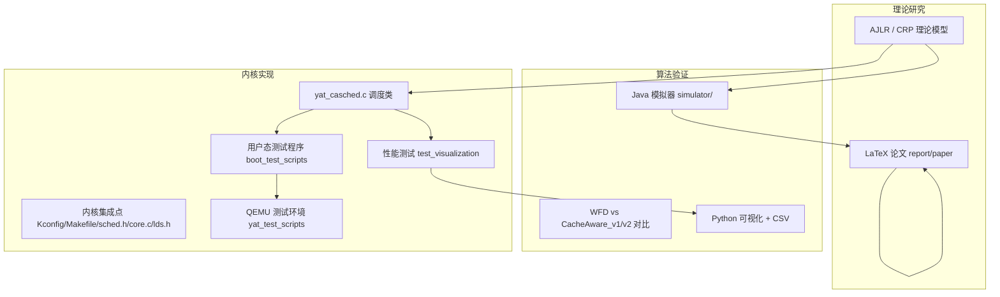

# Yat-CAShed 项目架构

> Yat-CAShed（Yet Another Task Cache-Aware Scheduler）是一个面向多核 Linux 系统的缓存感知任务调度项目，
> 覆盖「内核调度器实现 → 用户态测试 → 算法模拟器 → 实验可视化 → 论文」的完整研究链路。

## 1. 仓库组成

```
Yat-CAShed/
├── linux-6.8-main/     # Linux 6.8 内核源码 + Yat-CAShed 调度类（约 1.6G，含完整内核树）
├── simulator/          # Java 缓存感知调度算法模拟器（约 78M，绝大部分为 lib/*.jar）
├── report/             # 论文 LaTeX、参考 PDF、分析笔记（约 43M）
├── docs/               # ★ 新增：统一文档中心
├── README.md           # 顶层说明
├── Makefile            # ★ 新增：顶层编排入口
├── CONTRIBUTING.md     # ★ 新增：贡献指南
├── LICENSE             # ★ 新增：许可说明
└── .github/workflows/  # ★ 新增：CI（构建校验 + 冲突标记守卫）
```

## 2. 逻辑分层



## 3. 内核调度器模块

### 3.1 集成点（改动均分散在标准内核文件中）

| 文件 | 职责 |
|------|------|
| `kernel/sched/yat_casched.c` | 调度器核心实现（**决赛 AJLR 版**，冲突已解决） |
| `include/linux/sched/yat_casched.h` | 数据结构与接口声明 |
| `include/trace/events/yat_casched.h` | **A6**：6 个 tracepoint 定义（enqueue / dequeue / pick / place / **wakeup_place** / account） |
| `init/Kconfig` | `SCHED_CLASS_YAT_CASCHED` 配置项（`default n`）。放在 `init/Kconfig` 是**符合上游现状**的做法：6.8 中 `SCHED_*` 通用项都在这里，`kernel/sched/Kconfig` 并不存在 |
| `kernel/sched/Makefile:35` | `obj-$(CONFIG_SCHED_CLASS_YAT_CASCHED) += yat_casched.o` |
| `kernel/sched/sched.h:193` | `yat_casched_policy()` |
| `kernel/sched/core.c` | 调度类注册、优先级校验、`rq` 初始化等，共 10 余处 `#ifdef` |
| `include/linux/sched.h:801` | `task_struct` 增加 `struct sched_yat_casched_entity yat_casched` |
| `include/uapi/linux/sched.h` | `SCHED_YAT_CASCHED = 8` |
| `include/asm-generic/vmlinux.lds.h:135` | `__yat_casched_sched_class` 段注册（**A4** 已改为条件编译，见第 5 节 P8） |

> `DEFINE_SCHED_CLASS(name)` 宏定义在 `kernel/sched/sched.h:2361`，调度类顺序为
> `stop → dl → rt → fair → yat_casched → idle`（由 `core.c:9951` 的 `BUG_ON` 强校验；
> A4 已把该处校验改为**带诊断信息的 panic 消息**）。

### 3.1.1 可观测性接口（A6）

```
/sys/kernel/debug/yat_casched/
├── stats        # 7 项 per-CPU 计数器求和 + nr_cpu_ids
├── ready_pool   # 就绪池快照
├── dags         # DAG 列表 + 每个 DAG 的 waiting/ready/running 分布
└── placements   # ★ 决策采纳率：job_id pid prio assigned actual verdict + ok/denied/pending 汇总
```

`placements` 与 `stats` 的分工必须分清：`stats` 里的 `jobs_placed` 只统计
「**算过**多少次放置」，而 `placements` 的 `verdict` 统计的是「**算完有没有被采纳**」
（`ok` = 任务的 `task_cpu()` 等于 `assigned_cpu`；`denied` = 不等；
`pending` = 尚未落到任何 CPU）。AJLR 的实际接管率只能看后者。

- 注册时机：`late_initcall(yat_debugfs_init)`。debugfs 本身是 `core_initcall`，
  `sched_init()` 执行时它还不存在，因此不能在 `sched_init()` 里挂节点。
- 计数实现：`this_cpu_inc()` / `this_cpu_add()` 写入，读取端用
  `per_cpu_ptr()` + `offsetof()` 遍历求和，避免读时引入全局锁。
- **锁序要求**：三个 `_show` 函数全部使用 `spin_lock_irqsave()`。
  原因见 [CONFLICT_ANALYSIS.md §8.7](CONFLICT_ANALYSIS.md)：这些锁在调度热路径上
  总是在关中断状态下获取（`rq_lock` 是 irq-safe 的），普通 `spin_lock()` 会构成
  **真实的 IRQ 倒置 ABBA 死锁**。这一点是 QEMU 实跑时 lockdep 报出来的，不是理论推演。

```
```
tracepoint（运行时零开销；未启用时只是静态分支）
yat_casched:yat_casched_enqueue / _dequeue / _pick / _place / _wakeup_place / _account
```

- `_place` 是**算法内部**的评估结果（`yat_find_best_core_for_job()` 认为该放哪）；
- `_wakeup_place` 是**内核实际采纳**的结果（`select_task_rq` 的返回值），
  printk 后缀 `(stay)` / `(migrate)` 便于直接统计迁移率。
  两者不一致说明决策被亲和性校验或 `select_fallback_rq()` 推翻，是排查依据。

### 3.1.2 测试与基准入口（A7）

| 位置 | 只放什么 | 产物 |
|------|----------|------|
| `boot_test_scripts/` | **C 源码**：`yat_simple_test.c`（功能冒烟）、`yat_bench.c`（固定工作量基准） | 无（编译产物一律不放这里） |
| `yat_test_scripts/` | **Shell 脚本**：编译 / 打包 initramfs / 启动 QEMU / CFS vs YAT 对比 | `test_with_programs_build/`、`yat_test_scripts/results/` |

`compare_cfs_vs_yat.sh` 的设计约束：同一份 `bzImage`、同一份 initramfs、
同一份 `yat_bench` 二进制，通过内核命令行 `yatbench=cfs|yat` 切换策略，
两轮为**两个独立 QEMU 进程**，唯一变量是调度策略。
Makefile 侧由 `kernel-compare` 目标驱动。

### 3.2 调度类关键回调（`DEFINE_SCHED_CLASS`）

`.enqueue_task .dequeue_task .yield_task .yield_to_task .wakeup_preempt .pick_next_task
.put_prev_task .set_next_task .balance .select_task_rq .set_cpus_allowed .rq_online
.rq_offline .pick_task .task_tick .task_dead .switched_to .prio_changed .update_curr`

### 3.2.1 AJLR 决策链路（谁在真正决定放置）

```
try_to_wake_up()
  └─ select_task_rq(p, prev_cpu, WF_TTWU)        ← 内核唯一允许跨核「选核」的钩子
       ├─ job = yat_get_or_create_job(p)          （无则按默认 DAG 建，WCET = YAT_DEFAULT_WCET_NS）
       ├─ 粘性：目标核 nr_running == 0 → 直接沿用 assigned_cpu
       ├─ 节流：距 last_decision_ns < 1 ms → 直接沿用 assigned_cpu
       └─ yat_find_best_core_for_job(job)         （O(nr_cpus²)：CRP → 加速表 → 收益最大）
            └─ WRITE_ONCE(job->assigned_cpu, best)
  └─ 内核此后统一做 is_cpu_allowed → set_task_cpu → activate_task
       （因此本回调返回任何 CPU 都安全，亲和性由通用路径兜底）

enqueue_task / prio_changed  → 只同步 job_priority，不建新作业

pick_next_task
  ├─ 第一段：assigned_cpu == rq->cpu 或 YAT_INVALID_CORE 的任务里按 job_priority 选
  └─ 第二段：一个都没有时退回纯优先级扫描（上限 YAT_PICK_SCAN_LIMIT = 8）

task_dead  → yat_destroy_job(job)：作业生命周期与 task_struct 对齐，精确释放一次
```

**为什么不在 `balance()` 里迁移**：`class->balance()` 由 `put_prev_task_balance()`
在持有本核 `rq_lock` 时调用；跨核 `set_task_cpu()` 需要目标核 `rq_lock`，
这会构成 `rq_lock(A) → rq_lock(B)` 的嵌套，违反 A5 确立的锁序
（`rq_lock → global_dag_lock → dag->lock → pool->lock`，且 rq_lock 之间不嵌套）。
`select_task_rq` 则在 `p->pi_lock` 下运行、由通用路径完成迁移，天然规避该问题。

**为什么 `WF_FORK` / `WF_EXEC` 直接返回 `task_cpu`**：新进程此刻还没有历史记录，
`yat_calculate_recency()` 读到的是全零，重算得到的「最优核」是噪声。
`WF_TTWU` 才是缓存热度信息真正可用且会反复发生的时机。

### 3.3 两代实现（冲突根源与最终取舍）

| 维度 | 初赛版（HEAD 分支） | 决赛 AJLR 版（`yat/yat_casched-dev`） |
|------|--------------------|--------------------------------------|
| 核心思想 | 10ms 缓存热度窗口 + `last_cpu` 亲和 | CRP 预测 + 加速表 + 最大化加速时间效益 |
| 数据结构 | `history_record` 链表、静态 `accelerator_table` | DAG/Job、就绪作业池、哈希加速表 |
| 决策位置 | 本地 rq / `pick_next_task` | 全局调度（`balance` 于 CPU0 触发） |
| 典型常量 | `YAT_CACHE_HOT_TIME = HZ/100` | `YAT_TIME_SLICE = 4ms`、CRP 分段函数 |

> **最终取舍：采用决赛 AJLR 版（路线 A）**。初赛版的 `history_record` / `cpu_history_table` /
> 静态哈希 `accelerator_table` / `update_accelerator_table()` / `schedule_yat_casched_tasks()`
> 已整体移除，统一到 `yat_casched.h` 声明的 `yat_*` API。决策与执行明细见
> [CONFLICT_ANALYSIS.md](CONFLICT_ANALYSIS.md) §7–§8。

## 4. 模拟器模块（`simulator/`，Java 17+）

```
AlgorithmComparisonExperiment.java   # 实验主入口（8核 / 100案例 / 60任务 / 5档利用率）
LibraryVerification.java             # 依赖库自检
parameters/SystemParameters.java
entity/   Node, RecencyProfileReal
generator/ CacheHierarchy, EnhancedTaskGenerator, UUnifastDiscard
allocation/ AllocationMethods, WFD, CacheAware_v1, CacheAware_v2
analyzer/ PerformanceAnalyzer
visualizer/ ResultVisualizer.java, visualize.py, requirements.txt
lib/      commons-math3-3.6.1.jar（唯一运行时依赖，见 DEPENDENCIES.md）
tests/    YatSimulatorTest.java（58 条断言）
```

构建入口：[`Makefile`](../simulator/Makefile) 为**跨平台 GNU Make**（自动识别 OS/JDK/类路径分隔符），
Linux / macOS / WSL / Git-Bash 均可直接使用；Windows 亦可用 [`build.bat`](../simulator/build.bat)。

## 5. 已知结构性问题（本次整理范围）

| 编号 | 问题 | 位置 | 本次是否处理 |
|------|------|------|--------------|
| P1 | 合并冲突（10 处） | [`yat_casched.c`](../linux-6.8-main/kernel/sched/yat_casched.c) | ✅ 已按路线 A 解决 |
| P2 | 历史遗留的 `yat_global_pool_*` 声明已从接口中移除 | `yat_casched.h` | ✅ 已清理 |
| P3 | `sched.h` 重复 `#include <linux/sched/yat_casched.h>` | `sched.h:23` 与 `:76` | ✅ 修复 |
| P4 | 空源文件 | `boot_test_scripts/yat_scheduler_test.c`、`test_simple_history_validation.c`、`report/paper/Yat-CAShed_new.tex` | ✅ 清理 |
| P5 | 实现文档重复分叉 | 内核目录 vs `report/paper` | ✅ 已归档收敛到 [`docs/archive/`](archive/README.md) |
| P6 | 模拟器构建脚本仅支持 Windows | `simulator/Makefile` | ✅ 已改写为跨平台 GNU Make |
| P7 | 缺少 LICENSE / CONTRIBUTING / CI / .editorconfig | 仓库根 | ✅ 新增 |
| P8 | 调度类顺序依赖 `vmlinux.lds.h` 手工插段，脆弱 | `vmlinux.lds.h:135` | ✅ 已加 `#ifdef` 条件编译，未启用时不插入空段 |
| P9 | A5 静态审查发现的锁序/TOCTOU/UAF/原子上下文分配问题 | `yat_casched.c` | ✅ 已逐条修复（详见 [CONFLICT_ANALYSIS.md](CONFLICT_ANALYSIS.md) §8.7 与 ROADMAP A5） |
| P10 | debugfs `_show` 用普通 `spin_lock()` 读 irq-safe 锁 | `yat_casched.c` 三个 `_show` | ✅ **实跑 lockdep 报出真实死锁，已改 `spin_lock_irqsave`** |
| P11 | `printk` 散落、无法观测内部状态 | `yat_casched.c` | ✅ A6：6 个 tracepoint + 4 个 debugfs 节点 + 7 项 per-CPU 计数 |
| P12 | 测试目录职责混用、缺少 CFS vs Yat 自动对比 | `boot_test_scripts/`、`yat_test_scripts/` | ✅ A7：目录物理隔离 + `yat_bench.c` + `compare_cfs_vs_yat.sh` |
| P13 | **AJLR 决策不落地**：算出的放置只写进 debugfs 数字，主调度路径无人采纳（`jobs_placed` 恒 0） | `select_task_rq` / `pick_next_task` / `task_dead` | ✅ 已接线：`select_task_rq` 真正选核 + `assigned_cpu` 参与 pick + `.task_dead` 释放（见 §3.2.1） |
| P14 | 唤醒路径作业泄漏：每次 `enqueue_task` 新建 `yat_job` 并覆盖旧指针，旧作业永不释放 | `yat_ajlr_enqueue_task()` | ✅ 改为 `yat_get_or_create_job()` 复用 + `.task_dead` 精确释放 |

### 5.1 仍未解决的结构性问题（据实记录）

| 问题 | 说明 |
|------|------|
| ~~AJLR 就绪池未接入主调度路径~~ | ✅ **已关闭（P13）**。原状：`yat_ajlr_enqueue_task()` 只把 `yat_job` 绑定到 `task_struct`、不插入 `global_ready_pool`，而 `pick_next_task_yat_casched()` 从 `rq->yat_casched.tasks` 选任务，于是 `jobs_placed` / `history_records` / `accel_inserts` 常为 0。现由 `select_task_rq` 承担「全局放置」职责；就绪池仍只服务显式 DAG 路径，这是**有意的分工**——隐式任务作业不应被本地队列与全局池重复决策（见 `yat_update_ready_pool()` 的跳过条件）。 |
| AJLR 接管率尚未实测 | 新增的 `placements` 节点与 `_wakeup_place` tracepoint 已就位，但 `ok/denied/pending` 与 `(stay)/(migrate)` 的真实分布需在 `make kernel-compare` 里跑出。ROADMAP §1 的 CFS-vs-Yat 时间数据必须继续标注为「调度类切换本身的效果，非 AJLR 效果」。 |
| 决策节流常数未标定 | `YAT_DECISION_MIN_INTERVAL_NS = 1 ms` 是经验值；最优值依赖 D1' 的真实硬件代价模型。 |

### 5.2 已收敛的 P1 文档治理项（本轮关闭）

| 问题 | 处理结果 |
|------|----------|
| 两份「完整实现文档」分叉 | ✅ 已 `git mv` 到 [`docs/archive/`](archive/README.md)，加归档 banner，正文不改以保留历史真实性。当前事实来源是 `yat_casched.c` / `yat_casched.h` / 本文件 / `CHANGELOG.md`。 |
| 项目名多种写法并存 | ✅ 规范名定为 **`Yat-CAShed`**（依据：与 git remote、CI badge、论文标题、既有 `report/paper/Yat-CAShed.tex` 等外部不可变标识绑定）。补齐机械门禁 [`scripts/check_names.py`](../scripts/check_names.py)（`make name-check`），散文层残留可回归。内核代码标识符（`yat_casched`、`SCHED_YAT_CASCHED`）是独立命名空间，**不跟显示名**。 |
| LICENSE 对模拟器/文档未明确 | ✅ 见 [`LICENSE`](../LICENSE)：内核新增/修改文件 GPL-2.0；模拟器与本项目自有文档明确为「学术研究与教学使用，保留所有权利」，与第三方素材区分开。 |
