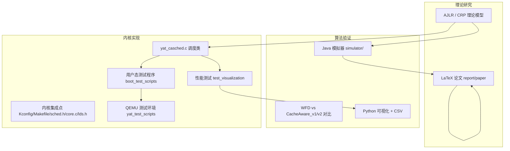

# Yat-CAShed 项目架构

> Yat-CAShed（Yet Another Task Cache-Aware Scheduler）是一个面向多核 Linux 系统的缓存感知任务调度项目，
> 覆盖「内核调度器实现 → 用户态测试 → 算法模拟器 → 实验可视化 → 论文」的完整研究链路。

## 1. 仓库组成

```
Yat-CAShed/
├── linux-6.8-main/     # Linux 6.8 内核源码 + Yat_Casched 调度类（约 1.6G，含完整内核树）
├── simulator/          # Java 缓存感知调度算法模拟器（约 78M，绝大部分为 lib/*.jar）
├── report/             # 论文 LaTeX、参考 PDF、分析笔记（约 43M）
├── docs/               # ★ 新增：统一文档中心
├── README.md           # 顶层说明
├── Makefile            # ★ 新增：顶层编排入口
├── CONTRIBUTING.md     # ★ 新增：贡献指南
├── LICENSE             # ★ 新增：许可说明
└── .github/workflows/  # ★ 新增：CI（构建校验 + 冲突标记守卫）
```

## 2. 逻辑分层



## 3. 内核调度器模块

### 3.1 集成点（改动均分散在标准内核文件中）

| 文件 | 职责 |
|------|------|
| `kernel/sched/yat_casched.c` | 调度器核心实现（**决赛 AJLR 版**，冲突已解决） |
| `include/linux/sched/yat_casched.h` | 数据结构与接口声明 |
| `kernel/sched/Kconfig` → 实际在 `init/Kconfig:1996` | `SCHED_CLASS_YAT_CASCHED` 配置项（`default n`） |
| `kernel/sched/Makefile:35` | `obj-$(CONFIG_SCHED_CLASS_YAT_CASCHED) += yat_casched.o` |
| `kernel/sched/sched.h:193` | `yat_casched_policy()`（**存在重复 include，见第 5 节**） |
| `kernel/sched/core.c` | 调度类注册、优先级校验、`rq` 初始化等，共 10 余处 `#ifdef` |
| `include/linux/sched.h:801` | `task_struct` 增加 `struct sched_yat_casched_entity yat_casched` |
| `include/uapi/linux/sched.h` | `SCHED_YAT_CASCHED = 8` |
| `include/asm-generic/vmlinux.lds.h:135` | `__yat_casched_sched_class` 段注册 |

> `DEFINE_SCHED_CLASS(name)` 宏定义在 `kernel/sched/sched.h:2361`，调度类顺序为
> `stop → dl → rt → fair → yat_casched → idle`（由 `core.c:9951` 的 `BUG_ON` 强校验）。

### 3.2 调度类关键回调（`DEFINE_SCHED_CLASS`）

`.enqueue_task .dequeue_task .yield_task .yield_to_task .wakeup_preempt .pick_next_task
.put_prev_task .set_next_task .balance .select_task_rq .set_cpus_allowed .rq_online
.rq_offline .pick_task .task_tick .switched_to .prio_changed .update_curr`

### 3.3 两代实现（冲突根源与最终取舍）

| 维度 | 初赛版（HEAD 分支） | 决赛 AJLR 版（`yat/yat_casched-dev`） |
|------|--------------------|--------------------------------------|
| 核心思想 | 10ms 缓存热度窗口 + `last_cpu` 亲和 | CRP 预测 + 加速表 + 最大化加速时间效益 |
| 数据结构 | `history_record` 链表、静态 `accelerator_table` | DAG/Job、就绪作业池、哈希加速表 |
| 决策位置 | 本地 rq / `pick_next_task` | 全局调度（`balance` 于 CPU0 触发） |
| 典型常量 | `YAT_CACHE_HOT_TIME = HZ/100` | `YAT_TIME_SLICE = 4ms`、CRP 分段函数 |

> **最终取舍：采用决赛 AJLR 版（路线 A）**。初赛版的 `history_record` / `cpu_history_table` /
> 静态哈希 `accelerator_table` / `update_accelerator_table()` / `schedule_yat_casched_tasks()`
> 已整体移除，统一到 `yat_casched.h` 声明的 `yat_*` API。决策与执行明细见
> [CONFLICT_ANALYSIS.md](CONFLICT_ANALYSIS.md) §7–§8。

## 4. 模拟器模块（`simulator/`，Java 17+）

```
AlgorithmComparisonExperiment.java   # 实验主入口（8核 / 100案例 / 60任务 / 5档利用率）
LibraryVerification.java             # 依赖库自检
parameters/SystemParameters.java
entity/   Node, RecencyProfileReal
generator/ CacheHierarchy, EnhancedTaskGenerator, UUnifastDiscard
allocation/ AllocationMethods, WFD, CacheAware_v1, CacheAware_v2
analyzer/ PerformanceAnalyzer
visualizer/ ResultVisualizer.java, visualize.py, requirements.txt
lib/      30+ 第三方 JAR（JGraphT、fastutil、jackson、commons-math3 等）
```

构建入口：[`Makefile`](../simulator/Makefile)（Windows 风格）与 [`build.bat`](../simulator/build.bat)（Windows 批处理）。
**注意**：Makefile 使用了 `if exist`、反斜杠路径等 cmd.exe 语法，在 Linux/macOS 下无法直接运行。

## 5. 已知结构性问题（本次整理范围）

| 编号 | 问题 | 位置 | 本次是否处理 |
|------|------|------|--------------|
| P1 | 合并冲突（10 处） | [`yat_casched.c`](../linux-6.8-main/kernel/sched/yat_casched.c) | ✅ 已按路线 A 解决 |
| P2 | 头文件声明的 `yat_global_pool_*` 系列**无实现**（7 个） | `yat_casched.h` | 记录（脚本白名单跟踪） |
| P3 | `sched.h` 重复 `#include <linux/sched/yat_casched.h>` | `sched.h:23` 与 `:76` | ✅ 修复 |
| P4 | 空源文件 | `boot_test_scripts/yat_scheduler_test.c`、`test_simple_history_validation.c`、`report/paper/Yat-CAShed_new.tex` | ✅ 清理 |
| P5 | 实现文档重复分叉 | 内核目录 vs `report/paper` | 记录 + 索引 |
| P6 | 模拟器构建脚本仅支持 Windows | `simulator/Makefile` | 记录 + 顶层封装 |
| P7 | 缺少 LICENSE / CONTRIBUTING / CI / .editorconfig | 仓库根 | ✅ 新增 |
| P8 | 调度类顺序依赖 `vmlinux.lds.h` 手工插段，脆弱 | `vmlinux.lds.h:135` | 记录 |
