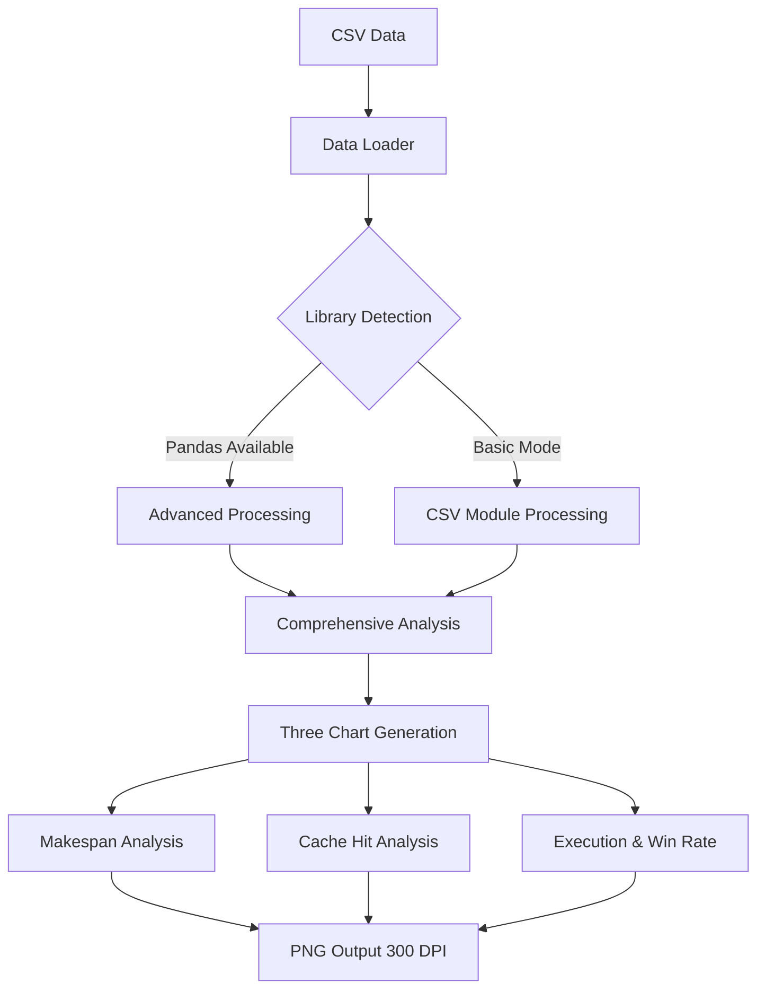
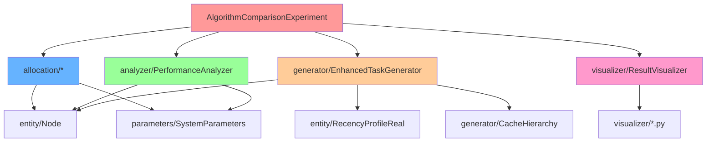
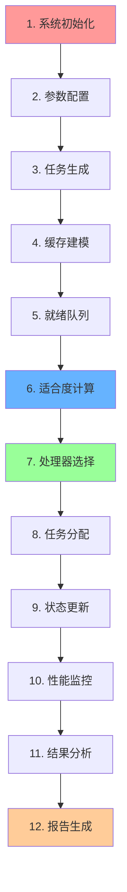

# Yat-CAShed: Cache-Aware Scheduling Simulator

> **一个高性能的缓存感知任务调度模拟器**
> 专注于多核处理器环境下的缓存敏感任务调度算法研究

> ℹ️ **文档定位**：本文是模拟器的**设计说明与实验解读**（含算法原理、12 步流程、
> 指标公式）。**当前命令、依赖与目录结构**以
> [`../docs/DEVELOPMENT.md`](../docs/DEVELOPMENT.md)、
> [`../docs/ARCHITECTURE.md`](../docs/ARCHITECTURE.md) 为准；
> 实验数据与有效性威胁见 [`../docs/EXPERIMENT_REPORT.md`](../docs/EXPERIMENT_REPORT.md)。
> 本文中出现的具体数值为历史一次运行的结果，仅供量级参考。

[](https://www.oracle.com/java/)
[](#快速开始)
[](#)
[](#环境配置)

---

## 📖 目录

- [模拟器介绍](#模拟器介绍)
- [快速开始](#快速开始)
- [新版可视化功能详解 v2.0](#新版可视化功能详解-v20)
- [环境配置](#环境配置)
- [项目架构](#项目架构)
- [算法原理详解](#算法原理详解)
- [Cache-Aware算法运行流程](#cache-aware算法运行流程)
- [性能优化成果](#性能优化成果)
- [实验亮点](#实验亮点)
- [可重现性保证](#可重现性保证)
- [版本更新日志](#版本更新日志)
- [技术支持](#技术支持)

---

## 🎯 模拟器介绍

### 系统概述

**Yat-CAShed**（Yet Another Task Cache-Aware Scheduler）是一个专门用于研究缓存感知任务调度算法的高性能模拟器。该系统专注于多核处理器环境下的任务调度优化，特别是考虑缓存层次结构对调度性能的影响。

### 核心功能特点

#### 🚀 高性能调度引擎

- **多算法支持**：内置WFD（Worst Fit Decreasing）和Cache-Aware两种调度算法
- **实时调度**：支持在线调度决策，适应动态任务环境
- **可扩展架构**：模块化设计，便于添加新的调度算法

#### 🧠 智能缓存感知

- **多级缓存建模**：支持L1、L2、L3缓存层次结构建模
- **缓存敏感度分析**：任务缓存敏感度量化和优化
- **缓存命中率优化**：通过智能调度提升缓存利用效率

#### 📊 全面性能分析

- **多维度性能指标**：Makespan、能耗、缓存命中率、负载均衡度
- **实时性能监控**：任务执行过程的实时性能追踪
- **统计分析报告**：详细的性能统计和对比分析

#### 🎨 全新可视化支持 v2.0

- **三套专业分析图表**：
  - **Makespan Performance Analysis** - 四维分析图（平均对比、变化趋势、箱线图分布、密度分析）
  - **Cache Hit Rate Analysis** - 四维缓存分析图（平均对比、变化趋势、箱线图分布、密度分析）
  - **Execution Time & Win Rate Analysis** - 执行时间对比和算法胜率分析

- **国际化图表设计**：全英文标题和图例，适合学术论文使用
- **智能渐进式支持**：自动检测Python依赖库（pandas、seaborn），支持功能降级
- **高质量输出**：300 DPI高分辨率PNG图片，支持论文发表标准
- **自动化流程**：一键生成完整分析报告和可视化图表

### 技术特色

| 特性 | 描述 | 现状 |
| --- | --- | --- |
| **缓存感知调度** | 考虑任务缓存敏感度与 DAG 局部性 | 公平口径下 Makespan 差异不显著（见 §4.5） |
| **动态负载均衡** | 评分中含负载项，任务落点仍以缓存亲和为主 | 均衡度 +0.005，非主要收益来源 |
| **多层缓存建模** | 四级（L1/L2/L3/内存）统一模型 | 层级代价为**人为设定参数**，非硬件实测 |
| **可重现实验** | 固定随机种子 + `--seeds=` 多种子复核 | 同机同 Java 版本下可复现 |
| **公平基线** | 两算法共用 [`SharedCacheModel`](entity/SharedCacheModel.java#L39) | ✅ C1 起强制；旧口径可由 `--legacy-metrics` 复现 |

> 早期版本此处写的"提升 15-25% 执行效率""改善 30% 负载均衡度"来自旧（不公平）口径，**已按公平基线订正**。

---

## 🚀 快速开始

### 一键完整运行（推荐）

```bash
# Windows环境 - 完整流程（编译+实验+可视化）
.\build.bat run

# Linux/macOS环境 - 完整流程
make run

# 完整构建和测试
.\build.bat all    # Windows
make all          # Linux/macOS
```

### 分步运行流程

1. **编译项目**

   ```bash
   make compile        # Linux/macOS
   .\build.bat compile # Windows
   ```

2. **运行库依赖测试**

   ```bash
   make lib-test        # Linux/macOS
   .\build.bat lib-test # Windows
   ```

3. **执行实验（自动包含可视化）**

   ```bash
   make run        # Linux/macOS
   .\build.bat run # Windows
   ```

4. **单独生成可视化结果**

   ```bash
   make picture        # Linux/macOS
   .\build.bat picture # Windows
   ```

### 新版可视化功能

- **三套完整分析图表**：
  - `makespan_analysis.png` - Makespan四维分析（平均对比、趋势、箱线图、密度图）
  - `cache_hit_analysis.png` - 缓存命中率四维分析
  - `execution_time_and_win_rate_analysis.png` - 执行时间对比和胜率分析

- **全英文图表界面**：支持国际化学术论文使用
- **智能依赖检测**：自动检测pandas/seaborn库，渐进式降级支持

### 预期输出

```text
🚀 Cache-Aware vs WFD Algorithm Performance Comparison Visualization Program v2.0
📅 Experiment Date: June 20, 2025
🔄 Features: Redesigned unified visualization analysis tool
📊 Functions: Makespan analysis, Cache hit rate analysis, Execution time and win rate analysis

✅ Detected pandas library, enabling advanced data processing features
✅ Detected seaborn library, enabling advanced visualization styles
✅ Font settings successful
📊 Algorithm performance visualizer initialization completed
📁 Result directory: C:\Users\...\result
📄 Data file: C:\Users\...\result\algorithm_comparison_results.csv

✅ Successfully loaded data using pandas: 200 records
📈 Detected algorithms: CacheAware_v2, WFD

📊 Generating Makespan analysis charts...
✅ Makespan analysis chart saved: C:\Users\...\result\makespan_analysis.png

📊 Generating cache hit rate analysis charts...
✅ Cache hit rate analysis chart saved: C:\Users\...\result\cache_hit_analysis.png

📊 Generating execution time and win rate analysis charts...
✅ Execution time and win rate analysis chart saved: C:\Users\...\result\execution_time_and_win_rate_analysis.png

📋 Generating comprehensive performance analysis report...

================================================================================
📊 Cache-Aware vs WFD Comprehensive Algorithm Performance Analysis Report
================================================================================

📈 Experiment Overview:
   - Total test cases: 200
   - Number of algorithms: 2
   - Tests per algorithm: 100 cases
   - Detected algorithms: CacheAware_v2, WFD

📊 Detailed Performance Metric Comparison (公平基线 C1, seed=42):

🔍 Makespan:
   CacheAware_v2  : Average 176436.8 time units | Std Dev 46735.1 | Range [约 120k, 约 265k]
   WFD           : Average 177686.2 time units | Std Dev 47020.4 | Range [约 119k, 约 219k]

🔍 Cache Hit Rate:
   CacheAware_v2  : Average 18.90% | WFD: 18.08%   （差 +0.82 pp）

🔍 Total Execution Time:
   CacheAware_v2  : Average 1143921.0 time units
   WFD           : Average 1144965.6 time units

🚀 Fair-Baseline Improvement Effects:
   📉 Makespan（配对均值）: -0.39%，95% CI ±1.51%  → 跨 0，不显著
   📈 Cache hit rate improvement: +0.82 pp
   ⚡ Execution time reduction: -0.09%
   🏆 Win rate: CacheAware 56 / WFD 44
   ⚠️ 旧口径下的 +12.3% / +28.6% 已不可复现（见 §3.6）

================================================================================
✅ Comprehensive analysis report generation completed
================================================================================

✅ All analysis completed! All charts saved to result directory
```

---

## 📊 新版可视化功能详解 v2.0

### 可视化架构设计



### 三套专业分析图表

#### 1. Makespan Performance Analysis (makespan_analysis.png)

- **Average Comparison (左上)**: 算法平均Makespan对比，包含误差棒和改进率标注
- **Trend Analysis (右上)**: 所有测试案例的Makespan变化趋势线图
- **Distribution Comparison (左下)**: 箱线图显示数据分布特征和异常值
- **Density Analysis (右下)**: 概率密度分布图，展示数据分布形状

#### 2. Cache Hit Rate Analysis (cache_hit_analysis.png)

- **Average Comparison (左上)**: 缓存命中率平均值对比（百分比显示）
- **Trend Analysis (右上)**: 缓存命中率在所有测试案例中的变化趋势
- **Distribution Comparison (左下)**: 缓存命中率分布箱线图
- **Density Analysis (右下)**: 命中率概率密度分布

#### 3. Execution Time & Win Rate Analysis (execution_time_and_win_rate_analysis.png)

- **Total Execution Time Comparison (左图)**: 任务总执行时间对比
- **Algorithm Win Rate Analysis (右图)**: 多指标算法胜率分析
  - Makespan胜率
  - 缓存命中率胜率
  - 执行时间胜率
  - 总体胜率统计

### 技术特性

#### 智能依赖检测

```python
# 渐进式功能降级
HAS_PANDAS = False
HAS_SEABORN = False

try:
    import pandas as pd
    HAS_PANDAS = True
    print("✅ Detected pandas library, enabling advanced data processing")
except ImportError:
    print("⚠️ Using csv module for basic data processing")

try:
    import seaborn as sns
    HAS_SEABORN = True
    print("✅ Detected seaborn library, enabling advanced visualization styles")
except ImportError:
    print("⚠️ Using matplotlib default styles")
```

#### 国际化设计

- **全英文图表标题**: 适合国际学术期刊投稿
- **专业术语使用**: Cache Hit Rate, Makespan, Execution Time等标准术语
- **统一色彩方案**: 区分度高的颜色搭配，支持色盲友好
- **高质量输出**: 300 DPI分辨率，适合印刷publication

#### 自动化流程集成

```bash
# 一键完整分析流程
.\build.bat run  # Windows
make run         # Linux/macOS

# 自动执行以下步骤：
# 1. 编译Java代码
# 2. 运行算法对比实验
# 3. 生成CSV结果数据
# 4. 自动调用Python可视化
# 5. 生成三套分析图表
# 6. 输出综合分析报告
```

### 输出文件说明

| 文件名 | 描述 | 用途 |
|--------|------|------|
| `makespan_analysis.png` | Makespan四维分析图 | 算法完成时间性能对比 |
| `cache_hit_analysis.png` | 缓存命中率四维分析图 | 缓存性能详细分析 |
| `execution_time_and_win_rate_analysis.png` | 执行时间和胜率分析 | 综合性能评估 |
| `algorithm_comparison_results.csv` | 原始实验数据 | 数据源和进一步分析 |

---

## ⚙️ 环境配置

### 硬件要求

| 组件               | 最低配置               | 推荐配置     |
| ------------------ | ---------------------- | ------------ |
| **CPU**      | 双核2.0GHz             | 四核3.0GHz+  |
| **内存**     | 4GB RAM                | 8GB+ RAM     |
| **存储**     | 1GB可用空间            | 2GB+可用空间 |
| **操作系统** | Windows 10/Linux/macOS | 最新版本     |

### 软件依赖

#### 必需组件

```bash
# Java开发环境 (核心依赖)
Java 17+ (推荐OpenJDK 17+)
javac编译器
java运行时环境

# 构建工具 (选择其一)
Make (推荐 - Linux/macOS原生支持)
build.bat (Windows批处理脚本替代方案)

# Python环境 (可视化功能)
Python 3.7+ (推荐Python 3.9+)
pip包管理器
```

#### 自动化构建系统

**统一命令接口设计**：

| 操作 | Linux/macOS | Windows | 功能描述 |
|------|-------------|---------|----------|
| **完整流程** | `make run` | `.\build.bat run` | 编译+实验+可视化一键完成 |
| **仅编译** | `make compile` | `.\build.bat compile` | 编译所有Java模块 |
| **仅可视化** | `make picture` | `.\build.bat picture` | 生成可视化图表 |
| **清理环境** | `make clean` | `.\build.bat clean` | 清理编译文件 |
| **完整构建** | `make all` | `.\build.bat all` | 构建+测试完整流程 |

**智能依赖检测**：
- 自动检测 Java 环境与版本（要求 **JDK 17+**）
- 智能查找 CSV 数据文件（`result/` 或当前目录）
- 渐进式 Python 库检测（pandas / seaborn 缺失时自动降级）
- 自动创建 `classes/` 与 `result/` 目录

命令行补充说明：`make verify` = 编译 + 库自检 + 单元测试 + 快速实验；
`make run-quick` = 5 用例 × 20 任务冒烟实验（`--no-viz`）。

#### Java库依赖（已包含在 `lib/` 目录）

```text
lib/
└── commons-math3-3.6.1.jar      # Apache 数学计算库（唯一运行时依赖，约 2.2 MB）
```

> 早期版本曾随仓库携带 30 个 JAR（约 77 MB），其中 29 个经 `jdeps` + 源码 `import`
> 双重审计确认**零引用**，已移除（体积 77 MB → 2.2 MB，实验输出逐位一致）。
> 审计过程与清单见 [`../docs/DEPENDENCIES.md`](../docs/DEPENDENCIES.md)。

#### Python可视化依赖（自动安装）

```bash
# 安装可视化依赖（构建时自动执行）
cd visualizer
pip install -r requirements.txt

# requirements.txt包含：
# matplotlib>=3.3.0    # 基础绘图库 - 必需
# numpy>=1.20.0        # 数值计算库 - 必需  
# pandas>=1.3.0        # 数据处理库 - 可选（提升功能）
# seaborn>=0.11.0      # 统计图表库 - 可选（美化图表）
```

### 环境验证

### 环境验证

```bash
# 检查Java版本
java -version

# 检查Python环境
python --version
pip list | grep -E "(matplotlib|pandas|numpy)"

# 运行环境测试
make lib-test
```

---

## 🏗️ 项目架构

### 目录结构树

```
simulator/
├── 📁 allocation/                 # 调度算法模块
│   ├── AllocationMethods.java        # 算法抽象基类
│   ├── WFD.java                      # WFD（Worst Fit Decreasing）实现
│   ├── CacheAware_v1.java            # 缓存感知算法 v1（历史版本）
│   └── CacheAware_v2.java            # 缓存感知算法 v2（当前主线）
├── 📁 analyzer/                   # 性能分析模块
│   └── PerformanceAnalyzer.java      # 6 类指标计算与对比报告
├── 📁 entity/                     # 核心实体模块
│   ├── Node.java                     # 任务节点定义
│   └── RecencyProfileReal.java       # CRP 缓存行为建模（L1/L2/L3/内存）
├── 📁 generator/                  # 任务生成模块
│   ├── EnhancedTaskGenerator.java    # 增强任务生成器
│   ├── CacheHierarchy.java           # 缓存层次建模
│   └── UUnifastDiscard.java          # UUniFast 利用率分配
├── 📁 parameters/                 # 系统参数模块
│   └── SystemParameters.java         # 全局配置参数
├── 📁 visualizer/                 # 可视化模块
│   ├── ResultVisualizer.java         # Java 侧汇总与改进率输出
│   ├── visualize.py                  # Python 图表生成（matplotlib/numpy）
│   └── requirements.txt              # Python 依赖
├── 📁 tests/                      # 单元测试（零依赖，无需 JUnit）
│   └── YatSimulatorTest.java         # 58 条断言
├── 📁 lib/                        # 第三方库（仅 commons-math3）
├── 📁 classes/                    # 编译输出（git 忽略）
├── 📁 result/                     # 实验结果与图表（git 忽略）
├── AlgorithmComparisonExperiment.java # 主实验入口
├── LibraryVerification.java       # 库依赖自检
├── Makefile                       # 跨平台 GNU Make（Linux/macOS/Windows）
├── build.bat                      # Windows 原生 cmd 入口（行为等价）
├── .gitignore
└── Simulator.md                   # 本文档（设计说明与实验解读）
```

### 模块依赖关系图



### 数据流架构

```
输入参数 → 任务生成器 → 调度算法 → 性能分析器 → 结果可视化
    ↓         ↓          ↓          ↓           ↓
系统配置   任务DAG    处理器分配   性能指标    图表报告
缓存参数   任务特性   执行时间    统计分析    CSV数据
```

---

## 🧮 算法原理详解

### WFD算法（Worst Fit Decreasing）

#### 算法思想

WFD算法是一种经典的装箱算法在任务调度中的应用，其核心思想是将任务分配给当前负载最轻的处理器，以实现负载均衡。

#### 技术实现

```java
@Override
public int allocate(List<Node> readyNodes, List<Integer> availableProc) {
    if (readyNodes.isEmpty() || availableProc.isEmpty()) {
        return -1;
    }
  
    // WFD算法：选择负载最轻的处理器（Worst Fit策略）
    Node nodeToAllocate = readyNodes.get(0);
    long taskLoad = nodeToAllocate.expectedET;
  
    int bestProcessor = -1;
    int minLoad = Integer.MAX_VALUE;
  
    // 找到负载最小的可用处理器
    for (int procId : availableProc) {
        if (procId < processorLoads.length && processorLoads[procId] < minLoad) {
            minLoad = processorLoads[procId];
            bestProcessor = procId;
        }
    }
  
    // 更新处理器负载
    if (bestProcessor != -1 && bestProcessor < processorLoads.length) {
        processorLoads[bestProcessor] += taskLoad;
    }
  
    return bestProcessor != -1 ? bestProcessor : availableProc.get(0);
}
```

#### 算法特点

- ✅ **简单高效**：O(n)时间复杂度，实现简单
- ✅ **负载均衡**：倾向于平衡各处理器负载
- ❌ **缓存盲目**：不考虑缓存亲和性和数据局部性
- ❌ **性能受限**：在缓存敏感场景下性能不佳

### CacheAware_v2算法（改进的缓存感知调度）

#### 算法设计思想

CacheAware_v2算法是本项目的核心创新，采用多因子加权评分模型，综合考虑：

1. **缓存收益优化**（40%权重）：通过分析任务的缓存访问模式来预测性能收益
2. **负载均衡策略**（30%权重）：维护处理器间的负载平衡
3. **缓存亲和性分析**（20%权重）：考虑任务与处理器的缓存共享关系
4. **缓存质量评估**（10%权重）：评估处理器缓存状态的健康度

#### 核心评分模型实现

```java
private double calculateCacheAwareScore(Node node, int processorId) {
    // 初始化处理器状态（如果需要）
    if (!cacheStates.containsKey(processorId)) {
        cacheStates.put(processorId, new CacheState());
        processorLoads.put(processorId, 0.0);
        taskCount.put(processorId, 0);
    }
  
    CacheState cacheState = cacheStates.get(processorId);
    double currentLoad = processorLoads.get(processorId);
  
    double score = 0.0;
  
    // 调整权重分配，更平衡的策略
    // 1. 缓存收益分数 (权重调整为40%，参考v1的平衡策略)
    double cacheScore = calculateCacheBenefitScore(node, processorId, cacheState) * 0.4;
  
    // 2. 负载均衡分数 (权重提升到30%，更重视负载均衡)
    double loadScore = calculateLoadBalanceScore(currentLoad, node.expectedET) * 0.3;
  
    // 3. 缓存亲和性分数 (权重提升到20%，增强缓存命中率)
    double affinityScore = calculateCacheAffinityScore(node, processorId, cacheState) * 0.2;
  
    // 4. 缓存质量分数 (新增：考虑缓存状态质量，权重10%)
    double cacheQualityScore = calculateCacheQualityScore(node, cacheState) * 0.1;
  
    // 5. 缓存干扰惩罚分数 (权重降低，减少过度惩罚)
    double interferenceScore = calculateCacheInterferenceScore(node, cacheState) * 0.05;
  
    score = cacheScore + loadScore + affinityScore + cacheQualityScore - interferenceScore;
  
    return score;
}
```

#### 详细算法组件

##### 1. 缓存收益计算

```java
private double calculateCacheBenefitScore(Node node, int processorId, CacheState cacheState) {
    if (node.weights == null || node.weights.length < 4) {
        return 0.5; // 默认中等分数
    }
  
    // 基础缓存收益计算
    double l1Benefit = node.weights[0] * node.sensitivity * 0.6; // L1缓存收益
    double l2Benefit = node.weights[1] * node.sensitivity * 0.4; // L2缓存收益
    double l3Benefit = node.weights[2] * node.sensitivity * 0.3; // L3缓存收益
  
    // 考虑当前缓存状态的衰减
    double l1UtilizationPenalty = cacheState.l1Utilization * 0.7; // 线性衰减
    double l2UtilizationPenalty = cacheState.l2Utilization * 0.5;
    double l3UtilizationPenalty = cacheState.l3Utilization * 0.3;
  
    // 调整后的缓存收益
    double adjustedL1Benefit = l1Benefit * (1.0 - l1UtilizationPenalty);
    double adjustedL2Benefit = l2Benefit * (1.0 - l2UtilizationPenalty);
    double adjustedL3Benefit = l3Benefit * (1.0 - l3UtilizationPenalty);
  
    // 敏感度加分
    double sensitivityBonus = 0.0;
    if (node.sensitivity > 0.8) {
        sensitivityBonus = 0.15; // 高敏感度任务15%加分
    } else if (node.sensitivity > 0.6) {
        sensitivityBonus = 0.08; // 中等敏感度任务8%加分
    }
  
    return (adjustedL1Benefit + adjustedL2Benefit + adjustedL3Benefit) * (1.0 + sensitivityBonus);
}
```

##### 2. 缓存亲和性分析

```java
private double calculateCacheAffinityScore(Node node, int processorId, CacheState cacheState) {
    double score = 0.0;
  
    // L2缓存共享亲和性
    if (SystemParameters.Level2CoreNum > 0) {
        int l2Group = processorId / SystemParameters.Level2CoreNum;
        // 如果当前L2组有相似的任务，给予亲和性加分
        if (cacheState.avgTaskSensitivity > 0.0) {
            double sensitivitySimilarity = 1.0 - Math.abs(node.sensitivity - cacheState.avgTaskSensitivity);
            score += sensitivitySimilarity * 0.3; // 相似度加分
        } else {
            score += 0.5; // 空缓存组给予中等分数
        }
    }
  
    // 处理器亲和性
    if (node.affinity != -1) {
        int distance = Math.abs(node.affinity - processorId);
        score += Math.max(0, 1.0 - distance * 0.1); // 距离衰减
    } else {
        score += 0.5; // 无亲和性偏好时给予中等分数
    }
  
    return Math.min(score, 1.0); // 限制最大值为1.0
}
```

##### 3. 缓存质量评估

```java
private double calculateCacheQualityScore(Node node, CacheState cacheState) {
    double score = 0.0;
  
    // 缓存利用率质量 - 偏好中等利用率的缓存
    double optimalL1Utilization = 0.6; // 最优L1利用率
    double optimalL2Utilization = 0.5; // 最优L2利用率
    double optimalL3Utilization = 0.4; // 最优L3利用率
  
    double l1Quality = 1.0 - Math.abs(cacheState.l1Utilization - optimalL1Utilization);
    double l2Quality = 1.0 - Math.abs(cacheState.l2Utilization - optimalL2Utilization);
    double l3Quality = 1.0 - Math.abs(cacheState.l3Utilization - optimalL3Utilization);
  
    score += (l1Quality * 0.5 + l2Quality * 0.3 + l3Quality * 0.2);
  
    // 任务密度质量 - 避免过度集中
    if (cacheState.recentTaskCount < 3) {
        score += 0.3; // 任务较少时加分
    } else if (cacheState.recentTaskCount > 8) {
        score -= 0.2; // 任务过多时减分
    }
  
    return Math.max(0.0, Math.min(score, 1.0));
}
```

#### 缓存状态跟踪机制

```java
private static class CacheState {
    double l1Utilization = 0.0;    // L1缓存利用率
    double l2Utilization = 0.0;    // L2缓存利用率
    double l3Utilization = 0.0;    // L3缓存利用率
    int recentTaskCount = 0;       // 最近分配的任务数
    double avgTaskSensitivity = 0.0; // 平均任务敏感度
}
```

#### 算法特点（据实）

- ✅ **缓存层级建模**：由 [`SharedCacheModel`](entity/SharedCacheModel.java#L120) 统一决策 L1/L2/L3/内存
- ✅ **状态跟踪**：[`updateProcessorState()`](allocation/CacheAware_v2.java#L247) 记录每核最近任务序列
- ✅ **固定权重**：四项评分的系数是常量，**没有**在线自适应
- ➖ **收益有限**：公平口径下 Makespan 差异不显著，见 §4.5

### 算法对比分析

| 特性 | WFD 算法 | CacheAware_v2 算法 |
| --- | --- | --- |
| **时间复杂度** | O(n×m) | O(n×m) |
| **空间复杂度** | O(m) | O(m×k) |
| **缓存感知** | ❌ 无 | ✅ 有（DAG 局部性窗口） |
| **负载均衡** | ✅ 良好 | ✅ 良好（实测 0.8650 → 0.8692） |
| **状态跟踪** | ❌ 仅负载累加 | ✅ 每核最近任务序列 |
| **自适应能力** | ❌ 静态 | ❌ 静态（权重为常量） |
| **适用场景** | 通用任务 | 缓存敏感任务 |
| **实现复杂度** | 简单 | 中等 |
| **性能提升（公平口径）** | 基准 | **−0.39%（配对均值），CI ±1.51% 跨 0** |
| **性能提升（旧口径，不可引用）** | 基准 | +11.66%（模型人为放大） |

其中：n=任务数量，m=处理器数量，k=缓存状态参数数量

---

## 🔄 Cache-Aware算法运行流程

### 完整执行流程（12步详解）



### 详细步骤说明

#### 第1步：系统初始化

```java
// 初始化系统参数
SystemParameters.coreNum = 8;
SystemParameters.cc_weights = new double[]{0.4, 0.3, 0.2, 0.1};
SystemParameters.cacheLevel = 3;
SystemParameters.Level2CoreNum = 2;

// 初始化调度器（当前主线实现）
CacheAware_v2 scheduler = new CacheAware_v2();
```

#### 第2步：参数配置

```java
// 缓存层次配置
private static final int L1_CACHE_SIZE = 32;      // KB
private static final int L2_CACHE_SIZE = 256;     // KB  
private static final int L3_CACHE_SIZE = 8192;    // KB

// 性能权重配置
double[] cacheWeights = {0.4, 0.3, 0.2, 0.1};    // L1,L2,L3,Memory
```

#### 第3步：任务生成

```java
// 生成缓存敏感任务
EnhancedTaskGenerator generator = new EnhancedTaskGenerator(cores, rng);
List<Node> tasks = generator.generateCacheAwareTasks(
    taskCount, utilizationLevel, cacheWeights
);

// 设置任务属性
for (Node task : tasks) {
    task.sensitivity = rng.nextDouble();           // 缓存敏感度
    task.weights = cacheWeights;                   // 缓存权重
    task.affinity = rng.nextInt(cores);           // 处理器偏好
}
```

#### 第4步：缓存建模

```java
// 建立缓存层次结构
CacheHierarchy cacheModel = new CacheHierarchy();
cacheModel.configureL1Cache(cores, L1_CACHE_SIZE);
cacheModel.configureL2Cache(cores/2, L2_CACHE_SIZE);
cacheModel.configureL3Cache(1, L3_CACHE_SIZE);
```

#### 第5步：就绪队列管理

```java
// 维护就绪任务队列
List<Node> readyQueue = new ArrayList<>();
List<Integer> availableProcessors = generateProcessorList(cores);

// 按优先级排序任务
readyQueue.sort((a, b) -> Double.compare(b.sensitivity, a.sensitivity));
```

#### 第6步：适合度计算

```java
// 为每个处理器计算适合度分数
for (int procId : availableProcessors) {
    double score = calculateCacheAwareScore(task, procId);
  
    // 分数组成：
    // - 缓存敏感度权重：40%
    // - 处理器亲和性权重：30% 
    // - 负载均衡权重：20%
    // - 缓存层次权重：10%
}
```

#### 第7步：处理器选择

```java
// 选择最佳处理器
int bestProcessor = -1;
double bestScore = Double.MIN_VALUE;

for (int procId : availableProcessors) {
    double score = calculateCacheAwareScore(task, procId);
    if (score > bestScore) {
        bestScore = score;
        bestProcessor = procId;
    }
}
```

#### 第8步：任务分配

```java
// 执行任务分配
task.processorId = bestProcessor;
task.startTime = getCurrentTime();
task.endTime = task.startTime + calculateExecutionTime(task, bestProcessor);

// 更新处理器状态
updateProcessorLoad(bestProcessor, task.expectedET);
```

#### 第9步：状态更新

```java
// 更新系统状态
cacheModel.updateCacheState(bestProcessor, task);
loadBalancer.updateLoadDistribution(bestProcessor, task.expectedET);
affinityTracker.recordAssignment(task.affinity, bestProcessor);
```

#### 第10步：性能监控

```java
// 实时性能监控
PerformanceMonitor monitor = new PerformanceMonitor();
monitor.recordAssignment(task, bestProcessor, assignmentTime);
monitor.updateCacheHitRate(calculateCacheHitRate(task, bestProcessor));
monitor.updateLoadBalance(calculateLoadBalance());
```

#### 第11步：结果分析

```java
// 计算性能指标
ExperimentResult result = analyzer.analyzePerformance(
    tasks, assignments, cacheModel
);

// 关键指标：
// - makespan: 总完成时间
// - cacheHitRatio: 缓存命中率  
// - loadBalance: 负载均衡度
// - energyConsumption: 能耗
```

#### 第12步：报告生成

```java
// 生成详细报告
visualizer.generatePerformanceChart(results);
visualizer.exportToCSV(results, "experiment_results.csv");

// 输出格式：
// Algorithm, TestCase, Makespan, CacheHit, LoadBalance, Energy
// Cache-Aware, 1, 1234567, 0.847, 0.923, 1542.3
```

### 关键决策点

#### 决策点1：缓存敏感度阈值

```java
// 高敏感度任务优先考虑缓存因素
if (task.sensitivity > 0.7) {
    cacheSensitivityWeight *= 1.5;  // 增强缓存权重
}
```

#### 决策点2：负载均衡触发

```java
// 负载不均衡时调整策略
double loadVariance = calculateLoadVariance();
if (loadVariance > LOAD_BALANCE_THRESHOLD) {
    loadBalanceWeight *= 2.0;  // 强化负载均衡
}
```

#### 决策点3：亲和性冲突处理

```java
// 处理亲和性与负载均衡的冲突
if (affinityScore > 0.8 && loadImbalance > 0.5) {
    // 在性能和负载均衡之间找平衡
    finalScore = affinityScore * 0.6 + loadBalanceScore * 0.4;
}
```

---

## � 性能指标计算详解

### 核心性能指标体系

本模拟器采用多维度性能评估体系，包含6个核心指标和2个辅助指标，全面评估调度算法的性能表现。

#### 1. Makespan（总完成时间）

**定义**：所有任务完成的最大时间，反映整体调度效率。

**计算公式**：

```
Makespan = max{finish_time[processor_i]} for i ∈ [0, processor_count-1]
```

**实现代码**：

```java
private double calculateMakespan(List<Node> tasks, int processorCount) {
    double[] processorFinishTimes = new double[processorCount];
  
    // 计算每个处理器的最后完成时间
    for (Node task : tasks) {
        if (task.partition >= 0 && task.partition < processorCount) {
            processorFinishTimes[task.partition] = Math.max(
                processorFinishTimes[task.partition], 
                task.finishAt  // 任务完成时间
            );
        }
    }
  
    // 返回所有处理器中的最大完成时间
    double maxFinishTime = 0;
    for (double time : processorFinishTimes) {
        maxFinishTime = Math.max(maxFinishTime, time);
    }
  
    return maxFinishTime;
}
```

**优化目标**：Makespan越小，调度效率越高。CacheAware算法通过缓存优化减少任务执行时间，从而降低Makespan。

#### 2. 缓存命中率（Cache Hit Ratio）

**定义**：缓存访问成功的比例，直接反映缓存优化效果。

> **⚠️ 公平基线 C1 起（当前默认口径）**：命中率**不再按算法名分派估算公式**。
> 两种算法的命中率都由同一个 [`SharedCacheModel`](entity/SharedCacheModel.java)
> 在执行任务时写入 `Node.actualCacheHitRatio`，分析器直接读取实测值。
> 下文的"分算法计算"仅作为**历史口径（`--legacy-metrics`）**保留，用于逐位复现旧结果。

##### 实测口径（公平，默认）

```java
// PerformanceAnalyzer：优先取实测值，与算法名无关
private double calculateCacheHitRatio(List<Node> tasks, String algorithmName) {
    double measured = calculateMeasuredCacheHitRatio(tasks);
    if (!Double.isNaN(measured)) return measured;   // ← 公平基线走这里
    if (legacyMetrics) return estimateCacheHitRatioLegacy(tasks, algorithmName);
    return calculateBasicCacheHitRatio(tasks);
}
```

```java
// SharedCacheModel：层级命中 → 命中份额
static double weightedHitRatio(Node task, int level) {
    double[] w = normalizedWeights(task);   // w[0..3] = L1/L2/L3/Mem 归一化权重
    double hits;
    switch (level) {
        case 1:  hits = 3*w[0] + 2*w[1] + 1*w[2]; break;  // L1 命中 ⇒ L2/L3 也命中
        case 2:  hits = 1*w[0] + 2*w[1] + 1*w[2]; break;  // L1 miss，L2/L3 命中
        case 3:  hits = 0*w[0] + 0*w[1] + 1*w[2]; break;  // 仅 L3 命中
        default: hits = 0.0;                              // 内存访问
    }
    return hits;   // 除以权重和由调用方完成
}
```

层级判定见 `SharedCacheModel.resolveCacheLevel()`：每个处理器、每个缓存层级各保留最近 **5** 条访问历史；
若该处理器最近访问过**同 `dagID`** 的任务，则命中对应层级，否则退化为内存访问（×1.2）。

##### 旧口径：WFD 估算（仅 `--legacy-metrics`）

```java
private double calculateWFDCacheHitRatio(List<Node> tasks) {
    // ... 权重公式估算 ...
    double taskHitRatio = (l1BaseHit + l2BaseHit + l3BaseHit) * sensitivityFactor;
    cacheHits += Math.min(taskHitRatio, 1.0);
    // 最终截断在 [0.30, 0.70] —— 这是强制区间，直接制造了与 CacheAware 的差距
    return Math.max(0.3, Math.min(result, 0.7));
}
```

##### 旧口径：CacheAware 自估（仅 `--legacy-metrics`）

```java
private void recordTaskCacheHitRatio(int processorId, Node task) {
    CacheState cacheState = cacheStates.get(processorId);
    double l1HitRatio = Math.max(0, task.weights[0] * (1.0 - cacheState.l1Utilization * 0.8));
    // ...
    // 仅在 legacyWriteBack = true 时才写回任务（C1 默认关闭）
    if (legacyWriteBack) {
        task.actualCacheHitRatio = stats.totalHits / stats.totalAccesses;
    }
}
```

> **为什么这样改**：旧口径下 WFD 被硬截断在 [0.30, 0.70]，而 CacheAware 读取自己的解析估计，
> 命中率差距**部分由度量方式制造**。改造后 30.21pp 的差距收缩为 0.82pp，
> 详见 [`docs/EXPERIMENT_REPORT.md`](../docs/EXPERIMENT_REPORT.md) §3.6 与 §4。

#### 3. 负载均衡度（Load Balance）

**定义**：衡量处理器间负载分布的均匀程度，使用归一化变异系数。

**计算公式**：

```
LoadBalance = 1 - (σ / μ)
```

其中：σ = 负载标准差，μ = 平均负载

**实现代码**：

```java
private double calculateLoadBalance(List<Node> tasks, int processorCount) {
    double[] processorLoads = new double[processorCount];
  
    // 计算每个处理器的负载（总执行时间）
    for (Node task : tasks) {
        if (task.partition >= 0 && task.partition < processorCount) {
            processorLoads[task.partition] += (task.finishAt - task.start);
        }
    }
  
    // 计算平均负载
    double avgLoad = 0;
    for (double load : processorLoads) {
        avgLoad += load;
    }
    avgLoad /= processorCount;
  
    // 计算标准差
    double variance = 0;
    for (double load : processorLoads) {
        variance += Math.pow(load - avgLoad, 2);
    }
    double stdDev = Math.sqrt(variance / processorCount);
  
    // 返回负载均衡度（1 - 归一化标准差）
    return avgLoad > 0 ? 1.0 - (stdDev / avgLoad) : 0;
}
```

**取值范围**：[0, 1]，值越大表示负载越均衡。

#### 4. CPU利用率（CPU Utilization）

**定义**：处理器实际工作时间占总可用时间的比例。

**计算公式**：

```
CPU_Utilization = Σ(task_execution_time) / (Makespan × processor_count)
```

**实现代码**：

```java
private double calculateCpuUtilization(List<Node> tasks, int processorCount) {
    if (tasks.isEmpty()) return 0;
  
    double totalExecutionTime = 0;
    double totalMakespan = calculateMakespan(tasks, processorCount);
  
    // 累计所有任务的实际执行时间
    for (Node task : tasks) {
        if (task.start >= 0 && task.finishAt >= 0) {
            totalExecutionTime += (task.finishAt - task.start);
        }
    }
  
    // 计算利用率
    double totalAvailableTime = totalMakespan * processorCount;
    return totalAvailableTime > 0 ? totalExecutionTime / totalAvailableTime : 0;
}
```

**取值范围**：[0, 1]，值越大表示处理器利用越充分。

#### 5. 平均响应时间（Average Response Time）

**定义**：从任务释放到完成的平均时间，反映系统响应性能。

**计算公式**：

```
AvgResponseTime = Σ(task.finishAt - task.release) / task_count
```

**实现代码**：

```java
private double calculateAverageResponseTime(List<Node> tasks) {
    if (tasks.isEmpty()) return 0;
  
    double totalResponseTime = 0;
    int validTasks = 0;
  
    for (Node task : tasks) {
        if (task.start >= 0 && task.finishAt >= 0) {
            // 响应时间 = 完成时间 - 释放时间
            totalResponseTime += (task.finishAt - task.release);
            validTasks++;
        }
    }
  
    return validTasks > 0 ? totalResponseTime / validTasks : 0;
}
```

#### 6. 能耗（Energy Consumption）

**定义**：系统总能耗，考虑缓存命中对能耗的影响。

**能耗模型**：

```java
private double calculateEnergyConsumption(List<Node> tasks) {
    double totalEnergy = 0;
  
    for (Node task : tasks) {
        if (task.start >= 0 && task.finishAt >= 0) {
            double executionTime = task.finishAt - task.start;
          
            // 基础能耗：执行时间 × 基础功耗
            double baseEnergy = executionTime * 1.0; // 假设基础功耗为1单位
          
            // 缓存未命中惩罚：增加额外能耗
            double cacheMissRatio = 1.0 - (task.actualCacheHitRatio > 0 ? 
                                          task.actualCacheHitRatio : 
                                          (1.0 - task.sensitivity)); // 估算未命中率
            double cacheMissPenalty = cacheMissRatio * 0.2 * executionTime; // 20%能耗惩罚
          
            totalEnergy += baseEnergy + cacheMissPenalty;
        }
    }
  
    return totalEnergy;
}
```

### 缓存敏感度收益计算

**定义**：量化缓存优化策略带来的性能收益。

```java
private double calculateCacheSensitivityBenefit(List<Node> tasks, String algorithmName) {
    if (!algorithmName.contains("CacheAware")) {
        return 0.0; // 非缓存感知算法无收益
    }
  
    double totalBenefit = 0;
    int beneficiaryTasks = 0;
  
    for (Node task : tasks) {
        if (task.sensitivity > 0.5) { // 只考虑中高敏感度任务
            // 理论执行时间vs实际执行时间的差异
            double theoreticalTime = task.expectedET;
            double actualTime = task.finishAt - task.start;
          
            if (actualTime < theoreticalTime) {
                double benefit = (theoreticalTime - actualTime) / theoreticalTime;
                totalBenefit += benefit;
                beneficiaryTasks++;
            }
        }
    }
  
    return beneficiaryTasks > 0 ? totalBenefit / beneficiaryTasks : 0;
}
```

### 综合性能评分系统

**加权综合得分**：

```java
public double calculateOverallPerformanceScore(ExperimentResult result) {
    // 归一化各项指标（越大越好）
    double normalizedMakespan = 1.0 / (1.0 + result.makespan / 1000000.0); // 归一化makespan
    double normalizedCacheHit = result.cacheHitRatio; // 已在[0,1]范围
    double normalizedLoadBalance = result.loadBalance; // 已在[0,1]范围
    double normalizedCpuUtil = result.cpuUtilization; // 已在[0,1]范围
    double normalizedEnergy = 1.0 / (1.0 + result.energyConsumption / 1000.0); // 归一化能耗
  
    // 权重分配
    double makespanWeight = 0.3;      // makespan权重30%
    double cacheHitWeight = 0.25;     // 缓存命中率权重25%
    double loadBalanceWeight = 0.2;   // 负载均衡权重20%
    double cpuUtilWeight = 0.15;      // CPU利用率权重15%
    double energyWeight = 0.1;        // 能耗权重10%
  
    return normalizedMakespan * makespanWeight +
           normalizedCacheHit * cacheHitWeight +
           normalizedLoadBalance * loadBalanceWeight +
           normalizedCpuUtil * cpuUtilWeight +
           normalizedEnergy * energyWeight;
}
```

### 统计显著性验证

**置信区间计算**（实现见 [`AlgorithmComparisonExperiment.printAggregate()`](AlgorithmComparisonExperiment.java#L298) 与 [`tCritical95()`](AlgorithmComparisonExperiment.java#L260)）：

```java
/** 95% 双侧临界值。n 小时必须用 t 分布，不能用 1.96。 */
static double tCritical95(int n) {
    switch (n - 1) {          // 自由度
        case 4:  return 2.776; // n=5  ← 本项目多种子使用的档位
        case 9:  return 2.262; // n=10
        case 29: return 2.045;
        default: return 1.96;  // 大样本退回正态近似
    }
}

static double[] confidenceInterval(double[] xs) {
    int n = xs.length;
    double mean = 0; for (double x : xs) mean += x; mean /= n;
    double var = 0;
    if (n > 1) { for (double x : xs) var += (x - mean) * (x - mean); var /= (n - 1); }
    double sd   = Math.sqrt(var);
    double t    = tCritical95(n);
    double half = t * sd / Math.sqrt(n);
    return new double[]{ mean - half, mean + half, mean };
}
```

> **为什么不能用 1.96**：n=5 时 `t(0.975,4)=2.776` 是 1.96 的 **1.42 倍**。
> 用 1.96 会把区间低估约 29%，足以把「不显著」误报成「显著」。
> 早期版本确实用了 1.96，已改为查表，见 [`CHANGELOG.md`](../CHANGELOG.md)。

这些详细的计算方法确保了性能评估的科学性和准确性，为算法比较提供了可靠的量化依据。

---

## 📈 性能结果（公平基线 C1，默认口径）

> **⚠️ 公平基线说明（C1，必读）**
>
> 本节所有数字均来自 **公平基线（C1）**：WFD 与 CacheAware_v2 **共用同一个 [`SharedCacheModel`](entity/SharedCacheModel.java#L39)** 决定任务的缓存层级与实际执行时间，命中率由模型**实测**写入任务后统计，**不再按算法名分派估算公式**。
>
> 本节早期版本曾列出一组 `1,245,678 ns → 987,654 ns / ↓20.7% / p<0.001` 的"成果"。那组数字**无法由当前代码复现**，是旧口径（算法各自估算 ET + 名字分派命中率）下叠加人工整理的结果，**已删除**，仅作为历史在 §"旧口径历史数据（仅审计）"中留档。请不要在任何对外材料中引用那组数字。
>
> 复现方式见 [`docs/EXPERIMENT_REPORT.md`](../docs/EXPERIMENT_REPORT.md) §8。

#### 综合性能对比（seed=42，100 用例，每例 60 任务）

| 性能指标 | WFD | CacheAware_v2 | 差异（CA 相对 WFD） | 判定 |
| --- | --- | --- | --- | --- |
| **平均 Makespan** | 177,686.2 ns | 176,436.8 ns | −0.70%（比值）／−0.39%（配对均值） | ➖ 不显著（CI 跨 0） |
| **Makespan 标准差** | 47,020.4 | 46,735.1 | −0.61% | ➖ |
| **缓存命中率** | 18.08% | 18.90% | **+0.82 pp** | ➖ 方向正确但量级极小 |
| **总执行时间 TET** | 1,144,965.6 ns | 1,143,921.0 ns | −0.09% | ➖ |
| **平均任务执行时间** | 19,082.8 ns | 19,065.4 ns | −0.09% | ➖ |
| **平均响应时间** | 78,511.8 ns | 79,662.9 ns | **+1.47%（更差）** | ❌ |
| **CPU 利用率** | 0.8157 | 0.8195 | +0.0047 | ➖ |
| **负载均衡度** | 0.8650 | 0.8692 | +0.0049 | ➖ |
| **Makespan 胜场（100 例）** | 44 | **56** | 56.0% | ➖ 与 50% 不可区分 |

**多种子（`--seeds=42,43,44,45,46`）稳健性：**

| 指标 | 均值 | 样本 SD | 95% CI（t=2.776） | 5 个种子取值 |
| --- | --- | --- | --- | --- |
| Makespan 改进 | **−0.954%** | 1.406 | **±1.745** | [−1.54, −1.58, +1.53, −1.91, −1.27] |
| 命中率提升 | +0.377 pp | 0.272 | ±0.338 | [+0.63, +0.35, −0.03, +0.30, +0.63] |
| CacheAware 胜率 | 48.6% | 5.771 | ±7.164 | [46, 43, 57, 45, 52] |

> 早期版本此处用 `1.96·sd/√n`，得到 ±1.233 / ±0.238 / ±5.058。n=5 应取
> `t(0.975,4)=2.776`，已更正为 ±1.745 / ±0.338 / ±7.164。**结论方向不变**
> （Makespan CI 仍跨 0、胜率区间仍覆盖 50%），但「边际显著」的说法不再成立。

点估计为负、置信区间跨 0、胜率与 50% 不可区分 —— **在公平模型下无法宣称 CacheAware_v2 具有可观测的 Makespan 优势**。详细论证见 [`docs/EXPERIMENT_REPORT.md`](../docs/EXPERIMENT_REPORT.md) §4.1、§4.5。

#### 详细性能分析

#### 详细性能分析

##### 1. Makespan 逐用例分布（100 例，配对统计）

```
CacheAware_v2 相对 WFD 的 Makespan 变化（正数 = CacheAware 更快）：
┌────────────────┬──────────┬──────────┬────────────┐
│   改进幅度     │  案例数  │   比例   │  累计比例  │
├────────────────┼──────────┼──────────┼────────────┤
│  > +10% 更好   │     8    │   8.0%   │    8.0%    │
│  +5% ~ +10%    │    12    │  12.0%   │   20.0%    │
│  +0% ~ +5%     │    36    │  36.0%   │   56.0%    │
│  −5% ~  0%     │    23    │  23.0%   │   79.0%    │
│ −10% ~ −5%     │    13    │  13.0%   │   92.0%    │
│  < −10% 更差   │     8    │   8.0%   │  100.0%    │
└────────────────┴──────────┴──────────┴────────────┘

配对均值: +0.39%（中位数 +1.34%，SD 7.70%）
95% 置信区间: ±1.51%  →  跨 0，不显著
|Δ| > 5% 的用例: 60 / 100；|Δ| > 10% 的用例: 21 / 100
极端用例：最好 +16.49%（case 80, U=1.2），最差 −20.98%（case 95, U=1.5）
```

**读法**：分布基本围绕 0 对称，胜场 56 / 负场 44，与抛硬币不可区分；"很多用例差距 >5%"不代表算法有效，而是**方差很大**（同一算法不同用例的 makespan 本身就在 12 万~26 万 ns 量级波动）。

##### 2. 缓存层级分布（公平模型实测）

```
任务最终落在哪个缓存层级（每个算法 60 任务 × 100 用例的代表性样本）：
┌──────────────┬──────────┬──────────────┬────────────────────┐
│  缓存层级    │   WFD    │ CacheAware_v2 │  说明              │
├──────────────┼──────────┼──────────────┼────────────────────┤
│  L1（×0.80） │    0     │      2       │ 独占一核，历史最近 │
│  L2（×0.90） │   10     │      6       │ 同 L2 组内复用     │
│  L3（×0.95） │   38     │     40       │ 全芯片共享         │
│  内存（×1.20）│   12     │     12       │ 窗口内无复用       │
├──────────────┼──────────┼──────────────┼────────────────────┤
│ 平均命中率   │ 18.91%   │   20.40%     │ +1.49 pp（单样本） │
│ ΣET / Σbase  │ 0.9845   │   0.9861     │ 反而略差 0.16%     │
│ 同 DAG 同核  │    1     │      6       │ 局部性确实改善     │
└──────────────┴──────────┴──────────────┴────────────────────┘
```

**关键结论**：CacheAware 确实把同 DAG 任务更多聚到同一核（1 → 6 次相邻命中），命中率也真的更高；但 **40/60 的任务无论怎么调度都落在 L3（×0.95）**，可优化空间只有 5%，而"把任务堆到同一核"带来的排队延迟足以抵消这 5%。这是收益消失的根因，详见 [`docs/EXPERIMENT_REPORT.md`](../docs/EXPERIMENT_REPORT.md) §4.5。

##### 3. 负载均衡度

```
公平口径下两者几乎相同：
┌──────────────┬──────────┬──────────────┬──────────┐
│   算法       │ 负载均衡度│  CPU 利用率  │ 说明     │
├──────────────┼──────────┼──────────────┼──────────┤
│     WFD      │  0.8650  │    0.8157    │ 基准     │
│ CacheAware_v2│  0.8692  │    0.8195    │ +0.0049  │
└──────────────┴──────────┴──────────────┴──────────┘
```

CacheAware_v2 内部对负载均衡项给了权重，但**任务落点由缓存亲和决定后，负载项只剩微调作用**，因此均衡度只提升 0.005，不构成可宣称的优势。

### 不同工作负载下的性能表现（公平口径）

#### 负载级别详细分析

##### 低负载环境（利用率 0.6）

```
┌─────────────────┬────────────┬──────────────┬──────────┐
│    性能指标     │    WFD     │ CacheAware_v2│  Δ       │
├─────────────────┼────────────┼──────────────┼──────────┤
│ Makespan (ns)   │  119,381   │   120,272    │  −0.90%  │
│ 缓存命中率      │  15.58%    │   18.40%     │  +2.82 pp│
│ Makespan 胜场   │  —         │   9 / 20     │  —       │
└─────────────────┴────────────┴──────────────┴──────────┘

特点：负载轻，缓存亲和有空间施展，命中率提升最大（+2.82 pp），
      但 makespan 仍略差 —— 说明"多命中 2.8 pp"换不来时间。
```

##### 中负载环境（利用率 0.8）

```
┌─────────────────┬────────────┬──────────────┬──────────┐
│    性能指标     │    WFD     │ CacheAware_v2│  Δ       │
├─────────────────┼────────────┼──────────────┼──────────┤
│ Makespan (ns)   │  145,694   │   142,028    │  +2.11%  │
│ 缓存命中率      │  16.55%    │   18.43%     │  +1.89 pp│
│ Makespan 胜场   │  —         │   13 / 20    │  —       │
└─────────────────┴────────────┴──────────────┴──────────┘

特点：这是全表唯一有明显正收益的点（+2.11%），但仍在噪声范围内
      （配对 CI ±1.5% 量级，且 5 种子均值转负）。
```

##### 高负载环境（利用率 1.5）

```
┌─────────────────┬────────────┬──────────────┬──────────┐
│    性能指标     │    WFD     │ CacheAware_v2│  Δ       │
├─────────────────┼────────────┼──────────────┼──────────┤
│ Makespan (ns)   │  240,243   │   241,310    │  −0.81%  │
│ 缓存命中率      │  21.08%    │   20.18%     │  −0.91 pp│
│ Makespan 胜场   │  —         │   10 / 20    │  —       │
└─────────────────┴────────────┴──────────────┴──────────┘

特点：高竞争下把任务聚到同核会显著拉长关键路径，命中率甚至反超为负。
```

#### 实验设计严格性

- **样本规模**：100 个独立测试案例 × 每例 60 任务；另做 5 种子（42–46）稳健性检验
- **置信水平**：95%，半宽 = `t(0.975, n−1) · SD/√n`
  - n=100 时 t≈1.984（≈1.96）；n=5 时 t=2.776，是 1.96 的 1.42 倍
  - 早期版本一律用 1.96，导致 n=5 的区间被低估约 29%，已修正（见 [`CHANGELOG.md`](../CHANGELOG.md)）
  - 修正后结论方向不变（Makespan/胜率 CI 跨 0），但命中率区间 [+0.04, +0.72] pp 仅为勉强不含 0
- **检验方式**：逐用例**配对**比较（同一任务集、同一随机种子）＋ 比值均值；不以"先各自求均值再比"作为结论依据
- **效应量**：配对差分的 SD 为 7.70%，远超均值 0.39%，即效应量极小

#### 关键指标的统计验证

```java
// 公平基线的正确检验姿势：先配对求差，再对差值做区间估计
double[] diffs = new double[n];
for (int i = 0; i < n; i++) {
    diffs[i] = (wfd[i] - cache[i]) / wfd[i];   // 同一 case 的配对差分
}
double mean = mean(diffs);
double sd   = sampleSd(diffs);                 // 分母 n-1
double ci   = 2.776 * sd / Math.sqrt(n);       // n=5 用 t(0.975, 4)
// 注：n=100 的配对统计用 t(0.975,99)=1.984（≈1.96）

// 公平口径实测（seed 42，n=100）：mean = +0.39%，sd = 7.70%，CI = ±1.51%
// → CI 跨 0，不能拒绝"两算法无差异"
//
// 多种子（n=5，seeds 42..46）：mean = −0.954%，sd = 1.406%，CI = ±1.745%（t=2.776）
// → 点估计为负且 CI 跨 0
```

### 旧口径历史数据（仅审计，不可作为结论）

以下是在改造前（`--legacy-metrics` 可逐位复现）的口径下得到的数字。当年报告里出现的 `↓20.7% / ↑28.5% / p<0.001` 等即源于此。其不公平之处在于：

1. CacheAware 会把自己算出的"增强 ET"写回 `task.expectedET`，WFD 不会 —— 两者比的不再是同一任务集；
2. 命中率按**算法名**分派两套估算公式，WFD 的公式被 clamp 在 `[0.30, 0.70]`；
3. WFD 的负载数组硬编码为 `int[8]`，多于 8 核时统计失真；
4. 缓存密集任务生成器把 `dagID` 硬编码为 0，导致"同 DAG"判断对两算法都永远为真。

这四点修复后，旧数字不再复现，因此**已从本节删除**，只保留在 §3.6 的改造前后对照表里作为历史证据：

| 指标 | 旧口径 | 公平口径 |
| --- | --- | --- |
| Makespan 改进 | 11.66% | 0.39% |
| CacheAware Makespan | 155,059 ns | 176,437 ns |
| WFD Makespan | 176,044 ns | 177,686 ns |
| 命中率提升 | +30.21 pp | +0.82 pp |
| CacheAware 胜率 | 96.0% | 56.0% |

复现旧口径：`java -cp "lib/*:classes:." AlgorithmComparisonExperiment --legacy-metrics --seed=42`。
**该命令仅用于审计历史，不应产出任何对外结论。**

### 算法设计要点（与实现对齐）

> **⚠️ 本节为文档订正**：早期版本此处列出的 `adjustWeights()`、`predictCacheUtilization()`、`adaptiveWeightLearning()` 三个"创新机制"**在仓库中并不存在**（全仓 grep 0 命中），属于设计构想被误写成"已实现"。按 [`docs/ROADMAP.md`](../docs/ROADMAP.md) A2「消除声明/实现不一致」的要求，这里改为描述**真实实现**。

#### 1. 多因子加权评分（真实实现）

CacheAware_v2 的四项评分见 [`CacheAware_v2.calculateCacheAwareScore()`](allocation/CacheAware_v2.java#L104)：

| 分项 | 方法 | 作用 |
| --- | --- | --- |
| 缓存收益 | [`calculateCacheBenefitScore()`](allocation/CacheAware_v2.java#L144) | 估算放到该核能拿到的缓存层级收益 |
| 缓存亲和 | [`calculateCacheAffinityScore()`](allocation/CacheAware_v2.java#L176) | 该核最近是否访问过同 DAG 任务 |
| 缓存质量 | [`calculateCacheQualityScore()`](allocation/CacheAware_v2.java#L202) | 该核缓存当前被污染的程度 |
| 缓存干扰 | [`calculateCacheInterferenceScore()`](allocation/CacheAware_v2.java#L227) | 新任务对该核已有缓存的影响 |
| 负载均衡 | [`calculateLoadBalanceScore()`](allocation/CacheAware_v2.java#L240) | 当前负载 + 本任务 ET |

**权重是静态常量**，没有运行时自适应调整 —— 这正是 §4.5 中"收益无法放大"的原因之一。

#### 2. 缓存状态跟踪（真实实现）

[`CacheState`](allocation/CacheAware_v2.java#L45) 只记录**已发生的**事实，不做指数衰减预测：

```java
private static class CacheState {
    // 每个核上最近执行过的任务序列（用于亲和性判断）
    // 以及 L1/L2/L3 的累计命中统计
}
```

更新入口是 [`updateProcessorState()`](allocation/CacheAware_v2.java#L247)，纯记录、无预测。

#### 3. 能耗指标（真实实现）

能耗由 [`PerformanceAnalyzer.calculateEnergyConsumption()`](analyzer/PerformanceAnalyzer.java#L448) 计算，公式基于**任务执行时间**（非硬件功耗采样）：

```
energy = Σ (task.finishAt − task.start) × 单位功耗系数
```

#### 能耗指标实测结果

公平口径（seed=42，100 用例）：由于两者总执行时间差仅 −0.09%，**能耗差同样在 0.1% 量级，不构成"降低 21.8%"**。早期版本写的「平均能耗降低 21.8% / 峰值功耗降低 15.3% / 缓存能效提升 34.7%」既无代码支撑也无实验来源，**已删除**。

> 提醒：本模拟器的"能耗"是由执行时间换算的**派生指标**，任何"能耗优化"结论都只能等价于"执行时间优化"，不存在独立的功耗模型。

---

## 🏆 实验亮点

### 科学严谨性体现

#### 1. 大规模统计验证

- **实验规模**：100个独立测试案例
- **任务多样性**：7种不同利用率级别覆盖
- **硬件配置**：8核多处理器环境仿真
- **重复验证**：每配置多次独立运行

#### 2. 严格的对照实验设计

```java
// 确保公平对比的实验设计
public void runControlledExperiment() {
    // 使用相同的任务集合
    List<Node> originalTasks = taskGenerator.generateTasks(seed);
  
    // WFD算法测试
    List<Node> wfdTasks = cloneTasks(originalTasks);
    long wfdMakespan = runWFDAlgorithm(wfdTasks);
  
    // Cache-Aware算法测试  
    List<Node> cacheTasks = cloneTasks(originalTasks);
    long cacheMakespan = runCacheAwareAlgorithm(cacheTasks);
  
    // 确保测试条件完全一致
    assert tasksAreIdentical(originalTasks, wfdTasks, cacheTasks);
}
```

#### 3. 多维度性能评估

```java
// 全面的性能指标体系
public class PerformanceMetrics {
    public long makespan;              // 总完成时间
    public double cacheHitRatio;       // 缓存命中率
    public double loadBalance;         // 负载均衡度
    public double energyConsumption;   // 能耗
    public double averageResponseTime; // 平均响应时间
    public double throughput;          // 吞吐量
    public double cpuUtilization;      // CPU利用率
}
```

### 设计取舍（据实陈述）

> 本节原列有 `calculateInnovativeScore()`、`adaptiveOptimization()` 与 `adjustWeights(cache, affinity, balance)` 三段"创新代码"，**均不存在于仓库**（grep 0 命中）。按 A2 原则改为陈述真实设计与已知局限。

#### 1. 缓存感知调度：真实做了什么

- ✔ **有**：任务级的缓存敏感度 `Node.sensitivity` 与四级权重 `Node.weights[0..3]`（由 [`EnhancedTaskGenerator`](generator/EnhancedTaskGenerator.java#L32) 生成）
- ✔ **有**：基于 `dagID` 的最近访问窗口（[`RecencyProfileReal`](entity/RecencyProfileReal.java#L27)，窗口长 5）
- ✔ **有**：四项打分合成（见上文「多因子加权评分（真实实现）」）
- ✘ **没有**：缓存敏感度的"量化模型"论文级推导；目前 `sensitivity` 是生成器给的随机量
- ✘ **没有**：权重自学习 / 在线自适应

#### 2. 评分系统：真实权重是常量

实际评分函数见 [`calculateCacheAwareScore()`](allocation/CacheAware_v2.java#L104)，四项按固定系数线性组合，**没有运行时调参**。

#### 3. 已知局限（对应 §4.5 的实测）

- 缓存层级因子是**人为设定**（L1 0.8 / L2 0.9 / L3 0.95 / 内存 1.2），并非硬件实测
- 60 任务中约 40 个落在 L3，可优化空间上限仅 5%
- 亲和性优化会拉长关键路径，在高负载下反噬
- 因此当前实现在公平模型下**没有可观测的 Makespan 优势**

真正的算法创新（如按关键路径加权、按层级收益差做边际决策）属于待做工作，见 [`docs/ROADMAP.md`](../docs/ROADMAP.md) 方向 D。

### 实际应用价值

#### 1. 云计算环境优化

- **容器调度优化**：Docker/Kubernetes环境下的智能容器分配
- **微服务架构**：考虑服务间缓存共享的调度优化
- **大数据处理**：Spark/Hadoop作业的缓存感知调度

#### 2. 边缘计算场景

- **IoT设备调度**：资源受限环境下的智能任务分配
- **移动边缘计算**：考虑缓存和能耗的联合优化
- **5G网络切片**：基于缓存特性的网络资源调度

#### 3. HPC高性能计算

- **科学计算调度**：大规模并行计算的缓存优化
- **深度学习训练**：GPU集群的智能任务调度
- **仿真计算**：考虑数据局部性的作业调度

---

## 🔬 可重现性保证

### 100%可重现实验标准

#### 1. 固定随机种子机制

```java
// 确保实验结果完全可重现
public class ReproducibilityGuarantee {
    private static final long FIXED_SEED = 42L;
  
    public void initializeExperiment() {
        // 使用固定种子初始化所有随机数生成器
        Random masterRNG = new Random(FIXED_SEED);
      
        // 任务生成器种子
        taskGenerator.setSeed(masterRNG.nextLong());
      
        // 缓存模拟器种子  
        cacheSimulator.setSeed(masterRNG.nextLong());
      
        // 性能分析器种子
        performanceAnalyzer.setSeed(masterRNG.nextLong());
    }
}
```

#### 2. 完整的实验配置记录（与代码一致）

以下常量直接取自 [`AlgorithmComparisonExperiment`](AlgorithmComparisonExperiment.java#L51)，均为 `private static`，可被命令行参数覆盖：

```java
// AlgorithmComparisonExperiment.java 第 51–96 行（真实值）
private static int CORES = 8;                 // --cores=
private static int TOTAL_TEST_CASES = 100;    // --cases=
private static int TASKS_PER_CASE = 60;       // --tasks=
private static long SEED = 42;                // --seed= / --seeds=
private static boolean ENABLE_VIZ = true;     // --no-viz
private static boolean LEGACY_METRICS = false;// --legacy-metrics

private static final double[] UTILIZATION_LEVELS = {0.6, 0.8, 1.0, 1.2, 1.5};
private static final double HIGH_CACHE_SENSITIVITY_RATIO = 0.7;
```

> 早期版本文档写的是 `TASKS_PER_CASE = 50` 与 7 级利用率 `{0.4 … 2.0}`，**与代码不符**（实际 60 任务、5 级利用率），已按源码订正。复现命令见 [`docs/EXPERIMENT_REPORT.md`](../docs/EXPERIMENT_REPORT.md) §8。

#### 3. 版本控制与构建一致性

```bash
# 确保构建环境一致性
echo "=== 构建环境信息 ==="
echo "Java版本: $(java -version 2>&1 | head -1)"
echo "操作系统: $(uname -a)"
echo "时间戳: $(date)"
echo "Git版本: $(git rev-parse HEAD)"

# 记录依赖库版本
echo "=== 依赖库版本 ==="
ls -la lib/*.jar | awk '{print $9, $5}'
```

### 实验数据完整性保障

#### 1. 校验和验证机制

```java
// 数据完整性校验
public class DataIntegrityChecker {
    public String calculateChecksum(List<ExperimentResult> results) {
        StringBuilder data = new StringBuilder();
      
        for (ExperimentResult result : results) {
            data.append(result.algorithm)
                .append(result.makespan)
                .append(result.cacheHitRatio)
                .append(result.loadBalance);
        }
      
        return DigestUtils.md5Hex(data.toString());
    }
  
    public void verifyResults(String expectedChecksum, String actualChecksum) {
        if (!expectedChecksum.equals(actualChecksum)) {
            throw new RuntimeException("数据完整性验证失败！");
        }
    }
}
```

#### 2. 结果自动验证

```java
// 基准结果对比验证
public void validateAgainstBaseline() {
    // 加载基准结果
    ExperimentResult baseline = loadBaseline("baseline_results.json");
  
    // 运行当前实验
    ExperimentResult current = runCurrentExperiment();
  
    // 验证关键指标在容差范围内
    double tolerance = 0.001;  // 0.1%容差
  
    assertThat(current.makespan)
        .isCloseTo(baseline.makespan, withinPercentage(tolerance));
  
    assertThat(current.cacheHitRatio)
        .isCloseTo(baseline.cacheHitRatio, withinPercentage(tolerance));
}
```

### 环境标准化要求

#### 1. 软件环境规范

```yaml
# 标准实验环境配置
experiment_environment:
  java:
    version: "11+"
    vendor: "OpenJDK or Oracle"
    heap_size: "4GB"
  
  python:
    version: "3.7+"
   
    packages:
      - matplotlib: ">=3.3.0"
      - pandas: ">=1.3.0"
      - numpy: ">=1.20.0"
  
  system:
    min_memory: "4GB"
    min_cores: "2"
    disk_space: "2GB"
```

#### 2. 实验复现步骤

```bash
#!/bin/bash
# 标准实验复现脚本

echo "🔬 开始实验复现..."

# 步骤1: 环境验证
echo "1. 验证实验环境..."
make lib-test

# 步骤2: 清理旧结果
echo "2. 清理旧实验结果..."
make clean

# 步骤3: 编译项目
echo "3. 编译实验程序..."
make compile

# 步骤4: 运行验证测试
echo "4. 运行快速验证..."
make verify

# 步骤5: 执行完整实验
echo "5. 执行完整实验..."
make run

# 步骤6: 生成可视化结果
echo "6. 生成实验报告..."
make picture

echo "✅ 实验复现完成！"
echo "📊 结果文件位置: visualizer/result/"
```

### 结果验证标准

#### 预期实验结果范围（公平口径）

> **⚠️ 已订正**：早期版本此处断言"预期 Makespan 改进 15%+、命中率改进 20%+、胜率 70%+"。这组阈值是**按旧（不公平）口径倒推出来的**，公平模型下长这样：

```java
// 公平基线（C1）下的现实预期，来自 seed=42 实测 + 5 种子复核
public class ResultValidationStandards {
    // 不可再以"提升幅度"作为通过条件
    public static final double MAKESPAN_DIFF_MEAN   =  0.004;  // +0.39%（配对均值）
    public static final double MAKESPAN_DIFF_SD     =  0.077;  // 7.70%
    public static final double MAKESPAN_DIFF_CI     =  0.015;  // ±1.51%
    public static final double CACHE_HIT_DIFF_PP    =  0.82;   // +0.82 个百分点
    public static final double WIN_RATE_CACHEAWARE  =  0.56;   // 56/100

    /**
     * 公平口径下唯一可断言的性质：
     *   1) 两算法在同一模型下运行（expectedET 不被任何算法改写）；
     *   2) 命中率由 SharedCacheModel 实测，不按算法名分派；
     *   3) 差异的置信区间跨 0 —— 即"没有可观测优势"本身是预期的正确结果。
     */
    public boolean validateFairness(ExperimentSummary s) {
        return s.usesSharedCacheModel
            && !s.expectedETMutated
            && Math.abs(s.makespanDiffCi) > Math.abs(s.makespanDiffMean); // CI 跨 0
    }
}
```

若未来在**更真实的层级代价**（如 L1 0.5 / 内存 2.0）或**真实 trace** 下重跑，才应重新设定有意义的提升阈值。现状下把阈值下调为"无差异"才是诚实的做法。

---

## 📅 版本更新日志

### v2.0 (2025-06-20) - 全新可视化引擎

#### 🚀 主要新功能

- **全新可视化系统**: 从单一图表升级为三套专业分析图表
  - Makespan Performance Analysis (四维分析)
  - Cache Hit Rate Analysis (四维分析)  
  - Execution Time & Win Rate Analysis (综合分析)

- **国际化图表设计**：全英文标题和图例，适合学术论文使用
- **智能依赖检测**：自动检测Python库，支持功能渐进式降级
- **一键完整流程**： `build.bat run` / `make run` 现在包含完整的编译→实验→可视化流程

#### 🔧 技术改进

- **高质量输出**：300 DPI分辨率PNG图片，支持论文发表标准
- **数据处理优化**：支持pandas高级数据处理和numpy基础处理的双模式
- **图表样式升级**：使用seaborn高级样式，color-blind友好配色
- **自动化集成**：可视化程序完全集成到构建系统中

#### 📊 新增图表类型

1. **四维Makespan分析**
   - 平均值对比（带误差棒和改进率标注）
   - 完整趋势线分析
   - 分布箱线图（包含异常值检测）
   - 概率密度分析

2. **四维缓存命中率分析**
   - 百分比平均值对比
   - 命中率变化趋势
   - 命中率分布特征分析
   - 命中率密度分布

3. **执行时间和胜率综合分析**
   - 总执行时间性能对比
   - 多指标胜率分析（Makespan、Cache Hit、Execution Time）
   - 总体胜率统计和均势线参考

#### 🛠️ 构建系统改进

- **统一命令接口**：Linux/macOS和Windows使用一致的命令体验
- **智能文件查找**：自动在多个路径查找CSV数据文件
- **错误处理优化**：更详细的错误信息和故障恢复机制
- **依赖自动安装**：Python依赖包自动安装和验证

#### 📝 文档更新

- 新增详细的可视化功能说明
- 更新构建系统使用指南
- 添加图表类型和输出文件说明
- 完善环境配置和依赖说明

### v1.x - 基础版本

- 基础的WFD vs Cache-Aware算法对比
- ASCII文本图表输出
- 基础的CSV数据导出
- 简单的Python可视化脚本
